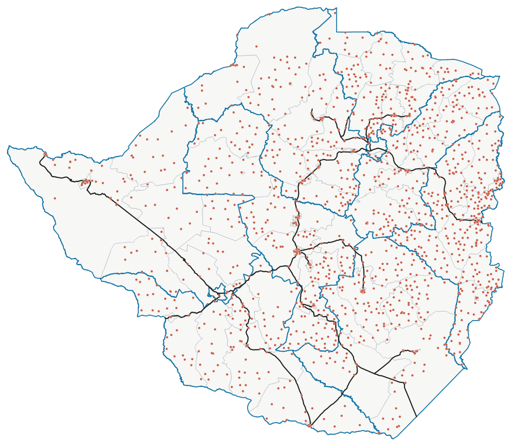

# Introduction to GIS with QGIS

A practical course by the **Zimgeo team** ([www.zimgeo.co.zw](https://www.zimgeo.co.zw), info@zimgeo.co.zw, kudzai@zimgeo.co.zw) that introduces Geographic Information Systems using free QGIS software and real Zimbabwe data.

The course is also published on the Zimgeo training page: [www.zimgeo.co.zw/training-tutorials](https://www.zimgeo.co.zw/training-tutorials/)

## Sessions

| Session | Topic | Data |
|---|---|---|
| 1 | What is GIS, spatial data types and vector data in QGIS ([Practical 1](practicals/Zimgeo_Intro_GIS_QGIS_Practical_1.docx)) | [intro_gis_session1_data.zip](https://github.com/zimgeozw/intro-gis-qgis-zimbabwe/raw/main/data/intro_gis_session1_data.zip) |
| 2 | Raster data (for enrolled students) | |
| 3 | Georeferencing (for enrolled students) | |
| 4 | Coordinate systems and UTM (for enrolled students) | |
| 5 | Data collection (for enrolled students) | |
| 6+ | Advanced data processing in QGIS (for enrolled students) | |

## Data downloads

**Session 1 (everything you need in one file):**
[intro_gis_session1_data.zip](https://github.com/zimgeozw/intro-gis-qgis-zimbabwe/raw/main/data/intro_gis_session1_data.zip) (6.8 MB): country, provinces, districts, rail network and health facilities.

**Individual layers:**

| File | Type | Contents |
|---|---|---|
| [zwe_admin0_country.zip](https://github.com/zimgeozw/intro-gis-qgis-zimbabwe/raw/main/data/zwe_admin0_country.zip) | Polygon | National boundary |
| [zwe_admin1_provinces.zip](https://github.com/zimgeozw/intro-gis-qgis-zimbabwe/raw/main/data/zwe_admin1_provinces.zip) | Polygon | 10 provinces |
| [zwe_admin2_districts.zip](https://github.com/zimgeozw/intro-gis-qgis-zimbabwe/raw/main/data/zwe_admin2_districts.zip) | Polygon | 91 districts |
| [zwe_admin3_wards_2018.zip](https://github.com/zimgeozw/intro-gis-qgis-zimbabwe/raw/main/data/zwe_admin3_wards_2018.zip) | Polygon | 1,961 wards (2018 boundaries) |
| [zwe_rail_network.zip](https://github.com/zimgeozw/intro-gis-qgis-zimbabwe/raw/main/data/zwe_rail_network.zip) | Line | Rail network, about 2,780 km |
| [zwe_health_facilities.zip](https://github.com/zimgeozw/intro-gis-qgis-zimbabwe/raw/main/data/zwe_health_facilities.zip) | Point | 1,470 health facilities (shapefile and CSV) |

All layers are ESRI Shapefiles in WGS 84 (EPSG:4326). Each zip contains a README with the source, fields and limitations.

## Data sources

- **Boundaries:** Zimbabwe National Statistics Agency (ZIMSTAT) and OCHA ROSEA, Common Operational Dataset of administrative boundaries (COD-AB), valid from 11 September 2018, [Humanitarian Data Exchange](https://data.humdata.org/dataset/cod-ab-zwe). Licence: CC BY-IGO.
- **Rail network:** Department of the Surveyor General, Zimbabwe, 1:250,000 base data.
- **Health facilities:** Ministry of Health and Child Welfare, Zimbabwe, facility database (recorded up to about 2007).

The ward boundaries date from 2018 and are older than the latest delimitation. The health facility data is old and incomplete. Both are suitable for learning GIS, but check current sources before using them for planning.

## Software

[QGIS](https://qgis.org) (free, Windows, Mac and Linux). Any version from 3.22 onwards works for these practicals; the screenshots use QGIS 3.34 LTR.

## Also from Zimgeo

[Zimbabwe Boundaries QGIS plugin](https://github.com/zimgeozw/qgis-zimbabwe-boundaries): country, provinces, districts and wards in one click.
